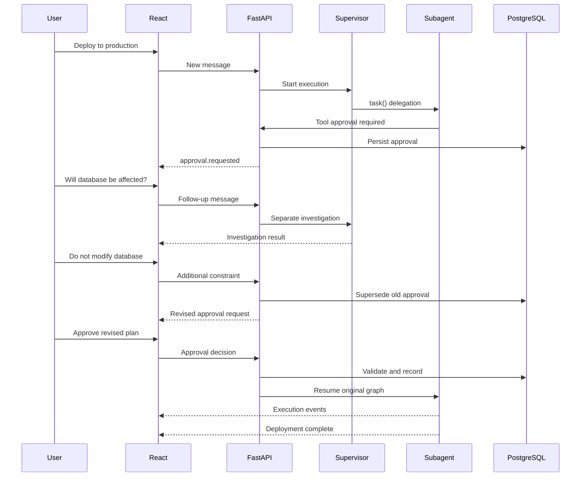

# DICE: Conversational HITL, Tool Approvals & Execution Resumption

**Implementation design — React + FastAPI + LangGraph + Deep Agents + PostgreSQL**

## 1. Objective

Build a conversational agent interface where the user can continue interacting with the Supervisor even when a subagent's execution is paused for approval or human input.

The system must support:

- Supervisor delegating work to subagents using `task()`.
- Subagents requesting approval before sensitive tool execution.
- The user asking follow-up questions while execution is paused.
- Supervisor answering those questions without accidentally resuming the original execution.
- The user providing additional constraints or modifying the proposed action.
- Explicit approval or rejection.
- Resuming the original LangGraph execution from its saved checkpoint.
- Preserving conversation history, execution events, approvals and task state.

**Core principle:** Conversation and execution are separate lifecycles. They share context, but they must not share an uncontrolled execution path.

---

## 2. Example user interaction

Consider this workflow:

| Step | Interaction | Execution state |
|---|---|---|
| 1 | User asks to deploy application to production. | Running |
| 2 | Supervisor delegates to infrastructure agent. | Running |
| 3 | Agent prepares Terraform changes. | Running |
| 4 | Terraform tool requests approval. | Waiting for approval |
| 5 | User asks whether database will be affected. | Still paused |
| 6 | Supervisor investigates the Terraform plan. | Original execution paused; investigation running separately |
| 7 | Supervisor explains the impact. | Original execution paused |
| 8 | User says not to modify database resources. | Original execution paused |
| 9 | Revised action is presented for approval. | Waiting for approval |
| 10 | User approves. | Resuming |
| 11 | Original infrastructure agent continues. | Running |
| 12 | Deployment completes. | Completed |

A normal user message is not an approval decision:

- "Why do you need approval?" → Answer the question.
- "Can you inspect the database impact?" → Run a separate investigation.
- "Change the target to staging." → Revise the proposed action and invalidate the previous approval.
- "Approved, proceed." → Resume the original execution only after validating the approval against the exact proposed action.

---

## 3. High-level architecture

```text
                     REACT FRONTEND
                           |
                    Conversation UI
                           |
                  FastAPI API Gateway
                           |
             +-------------+-------------+
             |                           |
       Conversation Handler        Execution Manager
             |                           |
       Supervisor Chat             LangGraph Root
             |                           |
       Follow-up Questions          task() delegation
       Context gathering                  |
       Investigation                Subagent execution
             |                           |
             |                    Tool approval request
             |                           |
             +-------------+-------------+
                           |
                    Approval Manager
                           |
                      PostgreSQL
                           |
                    Resume Coordinator
                           |
                    Command(resume=...)
                           |
                   Original graph resumes
```

### Component responsibilities

| Component | Responsibility |
|---|---|
| React | Render conversation, execution events, approvals and user input |
| FastAPI | API gateway, authentication, SSE and request validation |
| Conversation Handler | Handle messages while an execution is paused |
| Supervisor | Delegate tasks and communicate with the user |
| Deep Agents | Manage subagents and tool execution |
| LangGraph | Execution state, checkpointing, interrupts and resumption |
| Approval Manager | Approval lifecycle and authorization |
| PostgreSQL | Durable conversation, execution, approval and event records |
| Resume Coordinator | Resume the correct execution with the correct response |

---

## 4. Separate conversation state from execution state

Do not use one status field to represent both conversation and execution.

### Conversation state

```python
class ConversationStatus:
    ACTIVE = "active"
    IDLE = "idle"
```

### Execution state

```python
class ExecutionStatus:
    RUNNING = "running"
    WAITING_FOR_APPROVAL = "waiting_for_approval"
    WAITING_FOR_INPUT = "waiting_for_input"
    PAUSED = "paused"
    RESUMING = "resuming"
    COMPLETED = "completed"
    FAILED = "failed"
    CANCELLED = "cancelled"
```

A conversation can be active while its execution is waiting for approval.

```json
{
  "conversation_id": "conv_123",
  "conversation_status": "active",
  "execution": {
    "run_id": "run_456",
    "status": "waiting_for_approval",
    "thread_id": "thread_789",
    "pending_approval_id": "approval_001"
  }
}
```

This lets React continue accepting messages without accidentally starting a new execution.

---

# 5. React frontend implementation

## 5.1 Suggested UI structure

Use one unified conversation timeline.

```text
ChatPage
│
├── ConversationHeader
│
├── MessageTimeline
│   │
│   ├── UserMessage
│   ├── AssistantMessage
│   │
│   ├── DelegationCard
│   │   ├── SubagentStatus
│   │   ├── TodoList
│   │   ├── ToolActivity
│   │   └── ApprovalCard
│   │
│   ├── UserMessage
│   ├── AssistantMessage
│   └── InvestigationCard
│
├── PendingApprovalBanner
│
└── ChatComposer
```

The approval card belongs to the subagent that requested approval, but it is visible in the root Supervisor conversation.

## 5.2 TypeScript event models

```typescript
type ExecutionStatus =
  | "running"
  | "waiting_for_approval"
  | "waiting_for_input"
  | "paused"
  | "resuming"
  | "completed"
  | "failed";

type ApprovalStatus =
  | "pending"
  | "approved"
  | "rejected"
  | "expired"
  | "superseded";

interface ApprovalRequest {
  approvalId: string;
  runId: string;
  taskId?: string;
  agentName: string;
  toolCallId: string;
  toolName: string;
  arguments: Record<string, unknown>;
  argumentsHash: string;
  status: ApprovalStatus;
  description: string;
  createdAt: string;
}

interface AgentEvent {
  eventId: string;
  conversationId: string;
  runId?: string;
  type: string;
  agentName?: string;
  taskId?: string;
  timestamp: string;
  payload: Record<string, unknown>;
}
```

Use discriminated unions for production event models so that each event type has a strongly typed payload.

## 5.3 React state management

Zustand is a lightweight option for shared chat and execution state. Redux Toolkit is also appropriate if DICE already uses Redux.

```typescript
import { create } from "zustand";

interface ChatState {
  messages: AgentEvent[];
  approvals: ApprovalRequest[];
  executionStatus: ExecutionStatus;

  addEvent: (event: AgentEvent) => void;
  updateApproval: (approval: ApprovalRequest) => void;
  setExecutionStatus: (status: ExecutionStatus) => void;
}

export const useChatStore = create<ChatState>((set) => ({
  messages: [],
  approvals: [],
  executionStatus: "running",

  addEvent: (event) =>
    set((state) => ({
      messages: [
        ...state.messages.filter(
          (item) => item.eventId !== event.eventId
        ),
        event,
      ],
    })),

  updateApproval: (approval) =>
    set((state) => ({
      approvals: [
        ...state.approvals.filter(
          (item) => item.approvalId !== approval.approvalId
        ),
        approval,
      ],
    })),

  setExecutionStatus: (status) =>
    set({ executionStatus: status }),
}));
```

The `eventId` deduplication is important because reconnecting to SSE may deliver events that the client has already received.

## 5.4 Render approval cards

```tsx
interface ApprovalCardProps {
  approval: ApprovalRequest;
  onDecision: (
    approvalId: string,
    decision: "approve" | "reject"
  ) => Promise<void>;
}

export function ApprovalCard({
  approval,
  onDecision,
}: ApprovalCardProps) {
  const [loading, setLoading] = React.useState(false);

  async function decide(
    decision: "approve" | "reject"
  ) {
    setLoading(true);
    try {
      await onDecision(approval.approvalId, decision);
    } finally {
      setLoading(false);
    }
  }

  return (
    <div className="approval-card">
      <div className="approval-header">
        <h3>{approval.toolName}</h3>
        <span>{approval.status}</span>
      </div>

      <p>{approval.description}</p>

      <pre>
        {JSON.stringify(approval.arguments, null, 2)}
      </pre>

      {approval.status === "pending" && (
        <div className="approval-actions">
          <button
            disabled={loading}
            onClick={() => decide("approve")}
          >
            Approve
          </button>

          <button
            disabled={loading}
            onClick={() => decide("reject")}
          >
            Reject
          </button>
        </div>
      )}
    </div>
  );
}
```

For production, add an edit/review workflow, confirmation dialogs for high-impact actions, and explicit display of the target environment.

## 5.5 Chat composer while execution is paused

Do not disable the chat composer when an approval is pending.

```tsx
export function ChatComposer({
  conversationId,
}: {
  conversationId: string;
}) {
  const [message, setMessage] = React.useState("");

  async function sendMessage() {
    if (!message.trim()) return;

    await fetch(
      `/api/conversations/${conversationId}/messages`,
      {
        method: "POST",
        headers: {
          "Content-Type": "application/json",
        },
        body: JSON.stringify({ message }),
      }
    );

    setMessage("");
  }

  return (
    <div className="chat-composer">
      <textarea
        value={message}
        onChange={(e) => setMessage(e.target.value)}
        placeholder="Ask the Supervisor anything..."
      />

      <button onClick={sendMessage}>Send</button>
    </div>
  );
}
```

The backend decides whether this message belongs to an ordinary conversation turn, a follow-up investigation, a revised execution request, or an explicit approval/rejection.

---

# 6. FastAPI backend

## 6.1 API design

```http
POST /api/conversations/{conversation_id}/messages

GET  /api/conversations/{conversation_id}/events

GET  /api/runs/{run_id}

GET  /api/runs/{run_id}/approvals

POST /api/approvals/{approval_id}/decision

POST /api/runs/{run_id}/resume
```

The frontend sends all messages through the conversation endpoint. The approval endpoint is separate. This prevents a normal conversational message from accidentally being treated as a tool approval.

## 6.2 Conversation handler

The conversation handler should not directly resume the interrupted graph.

```python
async def handle_user_message(
    conversation_id: str,
    message: str,
    user_id: str,
):
    await db.save_user_message(
        conversation_id,
        user_id,
        message,
    )

    run = await db.get_active_run(conversation_id)

    if run and run.status == "waiting_for_approval":
        response = await conversation_handler.respond(
            conversation_id=conversation_id,
            user_message=message,
            pending_approval=await db.get_pending_approval(
                run.pending_approval_id
            ),
        )

        await db.save_assistant_message(
            conversation_id,
            response.message,
        )

        if response.proposed_action_changed:
            await approval_manager.supersede_old_approval(
                run.pending_approval_id
            )

            await approval_manager.create_new_approval(
                run_id=run.run_id,
                proposed_action=response.proposed_action,
            )

        return response

    return await execution_manager.start_or_continue(
        conversation_id=conversation_id,
        message=message,
    )
```

The `conversation_handler` can be a separate lightweight LangGraph graph or LLM workflow. It receives relevant context from the paused execution but does not share its execution checkpoint.

**Why separate graphs?** A paused LangGraph thread is waiting for an interrupt response. Sending an ordinary message to the same thread is not equivalent to answering that interrupt. Use a separate conversation/investigation execution with its own thread ID.

## 6.3 Investigation workflow

For the example, the user asks: "Will this deployment affect the database?"

The Supervisor can initiate a separate read-only investigation.

```python
async def investigate_deployment(
    run_id: str,
    question: str,
):
    run = await db.get_run(run_id)

    investigation_thread_id = (
        f"investigation-{run_id}-{uuid.uuid4()}"
    )

    context = await db.get_execution_context(run_id)

    result = await investigation_graph.ainvoke(
        {
            "question": question,
            "terraform_plan": context.terraform_plan,
            "deployment_context": context.metadata,
        },
        config={
            "configurable": {
                "thread_id": investigation_thread_id
            }
        },
    )

    return result
```

The investigation should be read-only by default. If it needs its own sensitive tool action, it must use the same approval policy.

---

# 7. LangGraph HITL and tool approval

## 7.1 Approval interrupt

LangGraph provides `interrupt()` to pause graph execution and wait for external input.

A simplified custom tool approval pattern:

```python
from langgraph.types import interrupt

def request_tool_approval(
    tool_name: str,
    arguments: dict,
):
    decision = interrupt({
        "type": "tool_approval",
        "tool_name": tool_name,
        "arguments": arguments,
        "message": "Please review this operation.",
    })

    return decision
```

In a real tool integration, place the approval boundary before the side effect. For Deep Agents, prefer the built-in tool approval configuration (`interrupt_on`) where supported.

## 7.2 Deep Agents configuration

Illustrative configuration:

```python
agent = create_deep_agent(
    model=model,
    tools=tools,
    subagents=subagents,
    checkpointer=checkpointer,
    interrupt_on={
        "terraform_apply": True,
        "delete_database": True,
        "send_email": True,
    },
)
```

Important version-specific behaviour:

- Declarative subagents inherit top-level `interrupt_on` configuration by default unless overridden.
- `CompiledSubAgent` instances do not inherit top-level approval configuration automatically. Configure HITL inside their compiled graph.
- Remote subagents also require their own approval configuration.

Verify the exact API against the installed Deep Agents version.

## 7.3 Resuming the original execution

```python
from langgraph.types import Command

async def resume_execution(
    thread_id: str,
    decision: dict,
):
    config = {
        "configurable": {
            "thread_id": thread_id,
        }
    }

    result = await root_graph.ainvoke(
        Command(resume=decision),
        config=config,
    )

    return result
```

The resume value must match the interrupt or Deep Agents HITL response schema.

For nested graphs, resume the root execution that owns the interrupted run. Do not independently invoke the worker as a fresh graph. The same thread ID must be used to resume the checkpoint.

---

# 8. Handling changed instructions

This is a critical safety rule.

Suppose the original approval request was:

```json
{
  "tool": "terraform_apply",
  "arguments": {
    "environment": "production"
  }
}
```

The user then says: "Don't modify the database."

This changes the intended execution constraints. The old approval must not be reused automatically.

### Correct flow

1. Supervisor receives the additional constraint.
2. Investigation checks whether the Terraform plan includes database changes.
3. If the proposed action changes, the old approval becomes `superseded`.
4. The revised action is generated.
5. A new approval is created.
6. User explicitly approves the revised action.
7. Backend validates the approval and resumes execution.

Use an immutable approval snapshot.

```python
{
    "approval_id": "approval_002",
    "run_id": "run_456",
    "tool_name": "terraform_apply",
    "arguments": {
        "environment": "production",
        "exclude_database": True
    },
    "arguments_hash": "sha256:...",
    "status": "pending"
}
```

The backend should verify that the action being executed matches the approved snapshot. A change in tool arguments, target environment, or other security-relevant properties requires fresh authorization.

---

# 9. PostgreSQL persistence model

Suggested tables:

### conversations

```sql
CREATE TABLE conversations (
    conversation_id UUID PRIMARY KEY,
    user_id UUID NOT NULL,
    status TEXT NOT NULL,
    created_at TIMESTAMPTZ DEFAULT NOW()
);
```

### executions

```sql
CREATE TABLE executions (
    run_id UUID PRIMARY KEY,
    conversation_id UUID NOT NULL,
    thread_id TEXT NOT NULL,
    status TEXT NOT NULL,
    active_task_id TEXT,
    pending_approval_id UUID,
    created_at TIMESTAMPTZ DEFAULT NOW(),
    updated_at TIMESTAMPTZ DEFAULT NOW()
);
```

### approval_requests

```sql
CREATE TABLE approval_requests (
    approval_id UUID PRIMARY KEY,
    run_id UUID NOT NULL,
    task_id TEXT,
    agent_name TEXT NOT NULL,
    tool_call_id TEXT NOT NULL,
    tool_name TEXT NOT NULL,
    arguments JSONB NOT NULL,
    arguments_hash TEXT NOT NULL,
    status TEXT NOT NULL,
    requested_by TEXT NOT NULL,
    decided_by TEXT,
    decision JSONB,
    created_at TIMESTAMPTZ DEFAULT NOW(),
    decided_at TIMESTAMPTZ
);
```

### conversation_messages

```sql
CREATE TABLE conversation_messages (
    message_id UUID PRIMARY KEY,
    conversation_id UUID NOT NULL,
    role TEXT NOT NULL,
    content JSONB NOT NULL,
    created_at TIMESTAMPTZ DEFAULT NOW()
);
```

### execution_events

```sql
CREATE TABLE execution_events (
    event_id UUID PRIMARY KEY,
    run_id UUID NOT NULL,
    task_id TEXT,
    event_type TEXT NOT NULL,
    payload JSONB NOT NULL,
    created_at TIMESTAMPTZ DEFAULT NOW()
);
```

Use the LangGraph PostgreSQL checkpointer for graph checkpoints. Keep application-level approval records and conversation events separate from LangGraph's internal checkpoint representation.

For reliability, use database transactions and an outbox pattern when recording approval decisions and scheduling graph resumption.

---

# 10. SSE event streaming

React needs to receive events from both the conversation handler and the execution graph.

Suggested normalized event types:

```typescript
type DICEEventType =
  | "message.created"
  | "agent.started"
  | "agent.completed"
  | "task.started"
  | "task.completed"
  | "tool.started"
  | "tool.completed"
  | "approval.requested"
  | "approval.approved"
  | "approval.rejected"
  | "approval.superseded"
  | "hitl.input_required"
  | "hitl.input_submitted"
  | "execution.paused"
  | "execution.resumed"
  | "execution.completed"
  | "execution.failed";
```

Example SSE message:

```text
id: evt_1001
event: approval.requested
data: {
  "run_id": "run_456",
  "task_id": "task_12",
  "approval_id": "approval_001",
  "agent_name": "infrastructure",
  "tool_name": "terraform_apply",
  "status": "pending"
}
```

FastAPI example:

```python
from fastapi.responses import StreamingResponse
import asyncio
import json

async def event_stream(conversation_id: str):
    last_event_id = None

    while True:
        events = await event_store.get_new_events(
            conversation_id,
            after=last_event_id,
        )

        for event in events:
            last_event_id = event.event_id

            yield (
                f"id: {event.event_id}\n"
                f"event: {event.event_type}\n"
                f"data: {json.dumps(event.payload)}\n\n"
            )

        await asyncio.sleep(0.5)


@app.get("/api/conversations/{conversation_id}/events")
async def stream_events(conversation_id: str):
    return StreamingResponse(
        event_stream(conversation_id),
        media_type="text/event-stream",
        headers={
            "Cache-Control": "no-cache",
            "X-Accel-Buffering": "no",
        },
    )
```

This is a simplified polling-based example. For production, use a durable event cursor, efficient notification mechanism, authorization checks and heartbeat handling.

SSE is a delivery mechanism, not the source of truth. On reconnection, React must be able to fetch the current execution state and pending approvals from PostgreSQL-backed APIs.

---

# 11. React SSE integration

```tsx
import { useEffect } from "react";

export function useConversationEvents(
  conversationId: string
) {
  const addEvent = useChatStore(
    (state) => state.addEvent
  );

  useEffect(() => {
    const source = new EventSource(
      `/api/conversations/${conversationId}/events`
    );

    const eventTypes = [
      "message.created",
      "agent.started",
      "agent.completed",
      "task.started",
      "task.completed",
      "tool.started",
      "tool.completed",
      "approval.requested",
      "approval.approved",
      "approval.rejected",
      "approval.superseded",
      "execution.paused",
      "execution.resumed",
      "execution.completed",
      "execution.failed",
    ];

    eventTypes.forEach((eventType) => {
      source.addEventListener(eventType, (event: MessageEvent) => {
        addEvent({
          eventId: event.lastEventId,
          conversationId,
          type: eventType,
          timestamp: new Date().toISOString(),
          payload: JSON.parse(event.data),
        });
      });
    });

    source.onerror = () => {
      console.warn("SSE connection interrupted");
    };

    return () => source.close();
  }, [conversationId, addEvent]);
}
```

For production authentication, note that the browser's native `EventSource` API does not allow arbitrary authorization headers. Use secure same-site cookies, or a fetch-based SSE client that supports authorization headers.

---

# 12. Approval decision API

React:

```typescript
async function submitApproval(
  approvalId: string,
  decision: "approve" | "reject"
) {
  const response = await fetch(
    `/api/approvals/${approvalId}/decision`,
    {
      method: "POST",
      headers: {
        "Content-Type": "application/json",
      },
      body: JSON.stringify({ decision }),
    }
  );

  if (!response.ok) {
    throw new Error("Approval decision failed");
  }

  return response.json();
}
```

FastAPI:

```python
@app.post("/api/approvals/{approval_id}/decision")
async def decide_approval(
    approval_id: str,
    request: ApprovalDecision,
    user=Depends(get_current_user),
):
    approval = await approval_manager.get(approval_id)

    await authorization.check_can_approve(
        user=user,
        approval=approval,
    )

    decision = await approval_manager.record_decision(
        approval=approval,
        user=user,
        decision=request.decision,
    )

    if decision.status == "approved":
        await resume_coordinator.enqueue(
            approval_id=approval_id
        )

    return {
        "approval_id": approval_id,
        "status": decision.status,
    }
```

The resume coordinator should process the decision asynchronously. It should validate that the approval is pending, that the arguments hash still matches, and that no other worker has already claimed the resume operation.

Use an idempotency key or unique decision constraint to prevent duplicate execution from repeated clicks or network retries.

---

# 13. Execution lifecycle



---

# 14. Important implementation safeguards

### 14.1 Never use the same paused thread for ordinary conversation

A follow-up question should not invoke the paused execution graph as a fresh user turn. Use a separate conversation/investigation graph and thread.

### 14.2 Avoid duplicate side effects

LangGraph restarts an interrupted node from its beginning when resumed. Code before the interrupt can execute again.

Therefore:

- Keep side effects after the approval boundary.
- Use idempotency keys for external actions.
- Do not perform a Terraform apply before the approval interrupt.
- Do not send an email before approval.
- Revalidate the approved action before execution.

### 14.3 Approval is not authorization

A user clicking Approve does not automatically mean they have permission to approve that action.

Validate:

- User identity.
- Role and permissions.
- Environment access.
- Approval policy.
- Approval status.
- Exact tool arguments.
- Whether the approval has expired or been superseded.

### 14.4 Handle multiple pending approvals

A single execution can have multiple interruptions. Associate every approval with its run, task, tool call and interrupt identity. Do not assume there is always only one pending approval.

### 14.5 Handle concurrency

Only one resume operation should claim a given pending interrupt. Use database transactions, optimistic locking or a unique job claim to avoid two workers resuming the same execution.

### 14.6 Don't silently execute changed plans

Any material change to an approved action must trigger a new approval.

---

# 15. Recommended React UX states

| UI state | What the user sees |
|---|---|
| Running | Agent activity and messages |
| Waiting for approval | Inline approval card |
| Waiting for input | Question or input card |
| Paused | Persistent paused indicator, composer remains active |
| Investigating | Separate investigation activity |
| Approval superseded | Previous approval marked outdated |
| Resuming | Resume indicator |
| Completed | Final response and execution summary |
| Failed | Error details and retry option |

A compact header can show:

```text
DICE Supervisor

Conversation: Active
Execution: Waiting for approval

[1 pending approval]
```

This makes it obvious that the user can continue talking while the underlying execution is paused.

---

# 16. Recommended implementation order

| Phase | Implementation |
|---|---|
| 1 | Unified React conversation timeline and SSE event model |
| 2 | Approval cards and approval decision API |
| 3 | Deep Agents tool approval and LangGraph checkpointing |
| 4 | Separate conversation handler for paused executions |
| 5 | Investigation workflow for follow-up questions |
| 6 | Revised proposal and approval invalidation |
| 7 | Resume coordinator and durable event handling |
| 8 | Concurrency, authorization and recovery tests |

## Acceptance criteria

1. User starts a task and a subagent requests approval.
2. User asks a question while approval is pending; the original execution remains paused.
3. Investigation completes without resuming the original execution.
4. User provides an additional constraint; the old approval is invalidated if the action changes.
5. User approves the revised action; the original graph resumes.
6. User rejects; the original graph follows the rejection path.
7. Browser refreshes while approval is pending; approval state is recovered.
8. SSE disconnects and reconnects; events are not lost or duplicated in the UI.
9. User clicks Approve twice; the tool is not executed twice.
10. Unauthorized user attempts approval; the backend rejects it.
11. A subagent has multiple pending approvals; each is independently tracked.
12. A resumed execution does not repeat previously completed external side effects.

---

# 17. Final architecture recommendation

For DICE, implement these as independent but connected subsystems:

- **Conversation Engine:** Handles user messages and Supervisor responses.
- **Execution Engine:** Runs the Supervisor and delegated subagents.
- **Approval Engine:** Controls sensitive tool execution and human decisions.
- **Resume Coordinator:** Resumes interrupted graph executions.
- **Event Engine:** Normalizes and persists events for React and SSE.

The most important architectural separation is:

**A user message is a conversation event. An approval is an execution-control event.**

Both appear in the same React timeline, but they follow different backend paths.

## Technical references

- [LangGraph interrupts](https://docs.langchain.com/oss/python/langgraph/interrupts)
- [LangGraph streaming](https://docs.langchain.com/oss/python/langgraph/streaming)
- [Deep Agents human-in-the-loop](https://docs.langchain.com/oss/python/deepagents/human-in-the-loop)
- [Deep Agents subagents](https://docs.langchain.com/oss/python/deepagents/subagents)
